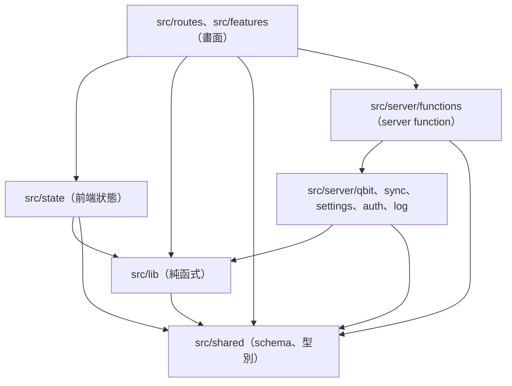
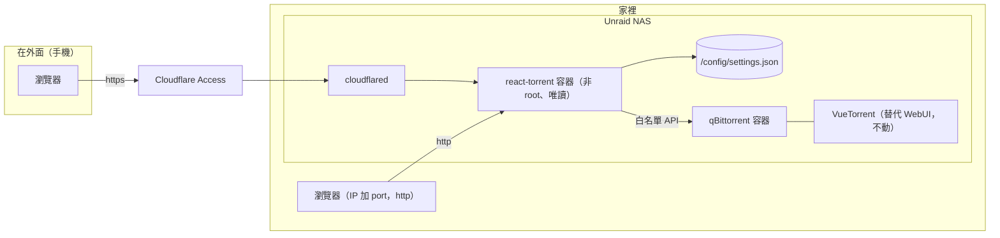

# 架構底稿：react-torrent

給之後的 epic、story 和自動開發流程用。這裡只寫「兩個 story 分開做會做得不一樣」的事。為什麼這樣決定，寫在同資料夾的 `.memlog.md`；審查紀錄在 `reviews/`。

標記：`[ADOPTED]` 是 Alex 親自選的；沒標的是 Claude 代決、Alex 看過接受的（memlog）。兩種一樣有效，story 不能自己改，要改先改這份。

## 設計模式

BFF（Backend for Frontend，專門服務這個前端的小後端）。一個容器，三件事：送網頁、當 qBittorrent 的白名單閘門、保管種子資料和設定檔。

| 層 | 放哪 | 做什麼 |
| --- | --- | --- |
| 畫面 | `src/routes/`、`src/features/<功能>/` | 畫畫面；讀 `state`、呼叫 `callFn` |
| 前端狀態 | `src/state/` | 前端共用的 store：勾選、待反映的操作、快捷鍵登記、可見順序的凍結 |
| 純函式 | `src/lib/` | 合併、篩選排序、狀態對應、路徑比對、格式化、info hash；不碰網路 |
| 共用格式 | `src/shared/` | 前後端共用的 zod schema、型別、錯誤 code、常數 |
| 接口 | `src/server/functions/` | server function，前後端唯一的接口；只匯出 server function |
| 伺服器 | `src/server/`（`qbit/`、`sync/`、`settings/`、`auth/`、`log/`） | 跟 qBittorrent 說話、保管種子表、讀寫設定檔、登入、log |



箭頭是「可以 import」，沒畫的方向都不行。用 ESLint 的 import 邊界規則把這張圖寫成設定，CI 擋。另外：`src/features/` 底下的功能之間不准互相 import，要共用就放 `state`、`lib` 或 `shared`。

## 規則

### AD-1：一個自己的容器，網頁和閘門同源 [ADOPTED]

- **Binds:** all
- **Prevents:** 有的功能從瀏覽器直接打 qBittorrent、有的走容器；開 CORS；做成 Cloudflare Workers 版本。
- **Rule:** 瀏覽器只跟這個容器說話。容器送網頁，也是唯一碰 qBittorrent 的程式。容器不回任何 CORS 標頭。VueTorrent 原本的網址和替代 WebUI 不動，但任何能碰到 qBittorrent WebUI 的對外網址都必須在 Cloudflare Access 後面。

### AD-2：兩道門，記住我 90 天 [ADOPTED]

- **Binds:** 登入、所有 server function
- **Prevents:** 只靠 Cloudflare Access 一道門；寫「分辨請求來自家裡或 Tunnel」的設定；偷到的 cookie 永遠能用。
- **Rule:** 從外面：先過 Cloudflare Access，再過 App 登入。在家用 IP 加 port：只過 App 登入，走 http 是接受的取捨，不加強制 https 或 HSTS。登入成功發 cookie `rt_session`：HttpOnly、SameSite=Strict，`getRequestProtocol()` 是 https 才加 Secure。簽章內容帶 `iat`、`exp`，伺服器每次檢查 `exp`：勾「記住我」90 天，不勾 12 小時。要讓所有裝置登出，就換 `SESSION_SECRET` 再重啟；不做登出按鈕。

### AD-3：App 登入就用 qBittorrent 帳密，帳密只在容器，登入鎖定是全域的 [ADOPTED]

- **Binds:** 登入、`src/server/auth`、`src/server/qbit`
- **Prevents:** 帳密進瀏覽器（localStorage、`VITE_` 變數）、進 git、進 log；猜密碼把容器 IP 害到被 qBittorrent 封鎖；靠可以偽造的 header 分辨來源；有 story 自己加一組 App 專用密碼。
- **Rule:** App 跟 VueTorrent 一樣只是 qBittorrent 的網頁介面，登入畫面打的就是 qBittorrent 的帳號密碼，不另設 App 密碼。接受的風險：這組密碼外洩等於 qBittorrent 全權，白名單（AD-5）擋的是偷到 cookie 和 XSS，不是偷到密碼。qBittorrent 帳密只放容器環境變數 `QBIT_USERNAME`、`QBIT_PASSWORD`。App 登入時，容器在自己這邊比對（兩邊先 SHA-256 再 `timingSafeEqual`），絕不把輸入轉給 qBittorrent。鎖定是全域計數：連錯 5 次鎖 15 分鐘，回 `login_locked`，放記憶體，被鎖時重啟容器。不讀 `CF-Connecting-IP`、`X-Forwarded-For` 做任何判斷。瀏覽器不存任何帳密。任何環境變數都不准用 `VITE_` 開頭放帳密。這條蓋過 UX `EXPERIENCE.md` 登入入口「帳密存在這台瀏覽器」那句。

### AD-4：qBittorrent 的 session 由容器保管，帳密錯就斷路

- **Binds:** `src/server/qbit`
- **Prevents:** 每個請求各自重登，幾十秒內錯滿 5 次，容器 IP 被 qBittorrent 封 1 小時；為了連得上去關掉 qBittorrent 的防護。
- **Rule:** session cookie 只在容器記憶體，名稱和值從 `auth/login` 回應的 `Set-Cookie` 原樣拿，不寫死 `SID`。登入成功的判斷：回應是 `Ok.` 而且有 `Set-Cookie`。同一時間只有一個重登在跑，其他請求等它的結果。qBittorrent 回 403 時重登一次再重送；重登回 `Fails.` 或 `auth/login` 回 403，容器就進入斷路：之後所有請求直接回 `qbit_auth_failed`，不再碰 `auth/login`，直到容器重啟。不准關掉 qBittorrent 的 CSRF 防護、Host 檢查、登入封鎖，不准打開「略過驗證」或 IP 白名單。

### AD-5：白名單閘門，每個 server function 都從同一個工廠出來 [ADOPTED]

- **Binds:** 所有 server function、所有碰 qBittorrent 的程式
- **Prevents:** 闖過登入的人改 qBittorrent 設定（例如「下載完成後執行外部程式」）拿到 NAS；有的函式忘了檢查登入；有的改東西用 GET；參數塞進 qBittorrent 的特殊值。
- **Rule:**
  - 每個 qBittorrent 操作在 `src/server/functions/` 寫成一個 server function。沒有 `/api/v2/*` 通用轉送。`app/setPreferences` 和其他改 qBittorrent 設定的 API 一律不開。除了 `GET /healthz` 不寫任何 server route。
  - 所有 server function 只能用 `src/server/functions/_define.ts` 的工廠建立（lint 擋其他地方直接呼叫 `createServerFn`）。工廠內建：登入檢查、zod 驗輸入、對 qBittorrent 30 秒逾時、把例外轉成 AD-9 的錯誤。
  - 改東西的一律 POST，讀取才 GET，讀取不能有副作用。
  - 不用登入的只有 `login` 和 `GET /healthz`。vitest 列出所有 server function，沒登入呼叫時，清單以外的每一個都要回 `not_logged_in`。
  - 送給 qBittorrent 的參數一律用 `URLSearchParams` 或 `FormData` 組，每個 schema 只取自己的欄位，不把前端物件整包送出。

### AD-6：種子資料由容器保管，前端只拿變動

- **Binds:** 看下載進度、篩選分類、排序、詳情、全域速度、連線狀態
- **Prevents:** 列表、看板、詳情各自打 API，數字對不起來；qBittorrent 的 `rid` 跟 session 綁，電腦和手機同時開時每 5 秒都拿全部 4165 個種子；合併邏輯各寫一套；`rid` 倒退。
- **Rule:**
  - 容器用自己的 `rid` 跟 qBittorrent 同步，只在最近 30 秒內有前端來要資料時才同步。容器記憶體裡有一張完整、瘦身過的種子表（只留畫面用得到的欄位，欄位清單在 `src/shared/maindata.ts`），每個種子記 `changedAt` 版本號，刪掉的 hash 留墓碑 10 分鐘。
  - 前端每 5 秒呼叫 `getMaindata({ since })`，`since` 是上次拿到的 `version`。容器回 `{ version, full, changed, removed, serverState, categories }`；`since` 太舊或容器重啟過就回 `full: true` 的整份。
  - 前端只用 `src/lib/maindata-merge.ts` 一個純函式套用，`full` 時整份取代，沒變的種子保留原物件（列元件用 hash 當 key 並 memo）。結果放在 TanStack Query 的 `['maindata']`。只有這個函式能寫 `['maindata']`（lint 擋 `setQueryData(['maindata']`）。
  - 列表、看板、詳情、分類數量、速度、連線狀態都從 `['maindata']` 推出來。看板「捲到底載入下一批」只是畫面虛擬化，不向伺服器分頁要資料。
  - 檔案分頁例外：只在打開時每 5 秒抓那一個種子的檔案，key 是 `['files', hash]`。
  - 排序欄位例外（2026-11-16 Story 2.1，Alex 決定）：51 種排序裡，種子表沒有的欄位（人數、上限、流量、comment、內容路徑、infohash 等）不進種子表。容器另外存這些欄位，只在排到那些排序時，前端每 5 秒呼叫 `getSortKeys({ field, since })` 拿「那一個排序」每個種子的值（衍生值在容器用 `src/lib` 的純函式算），key 是 `['sort-keys', field]`。理由：全部塞進種子表時，4167 個種子的完整資料從約 1.3 MB 變約 4.8 MB，每 5 秒的變動超過 160 KB 的預算。
  - 詳情例外（2026-11-17 Story 2.4，Alex 決定）：詳情要畫、種子表沒有的少數欄位（2.4 的已下載、已上傳；2.5 加來源數、在抓的人），詳情打開時前端每 5 秒呼叫 `getTorrentDetail({ hash })`，只拿正在看的那一個種子。容器從排序用的第二張表讀，重用 6 秒內已經跑過的 `sync/maindata` 同步（種子資料每 5 秒會同步一次，所以平常不會多問 qBittorrent）；超過 6 秒沒同步才自己同步一次。key 是 `['torrent-detail', hash]`，換種子就換 key，不顯示上一個種子的值。只送 `src/shared/torrent-detail.ts` 列出的欄位。理由：放進種子表時每 5 秒的變動超過 160 KB 預算（約 174 KB）；用 `getSortKeys` 又要為一個種子拿全部種子的值。
  - tracker 只存網域（容器從 tracker 網址算出來），完整 tracker 網址（裡面有 passkey）和 magnet 永遠不出容器（2026-11-16 Alex 決定）。comment、內容路徑、根路徑、infohash 只經由 `getSortKeys` 送出。
  - 分頁不在前景時停止輪詢，回到前景立刻拿一次。`['maindata']` 失敗時保留舊資料。

### AD-7：操作成功後等 qBittorrent 說了算

- **Binds:** 刪除、新增、改路徑、改檔名、暫停繼續、檔案勾選
- **Prevents:** 有的功能先改本機資料（樂觀更新）、有的等伺服器；操作後的手動抓取跟輪詢撞在一起；「搬移中」的目標路徑沒人記、關掉對話框就沒人等搬完。
- **Rule:**
  - 操作成功後不自己改資料，呼叫 `src/state` 唯一的 `refreshMaindata()`（取消在途請求、立刻抓一次）。檔案分頁的操作改成重抓 `['files', hash]`。EXPERIENCE 說的「那一列自己變」指重抓後的結果。
  - 搬移目標由容器記：`setLocation` 成功時容器在種子表記 `movingTo`，`getMaindata` 跟著回，搬完（看過 `moving` 又離開，或 `save_path` 等於目標）就刪掉。前端看到 `movingTo` 消失才出完成 toast，只在發起的那台出。
  - 「已送出、qBittorrent 還沒反映」的畫面處理只走 `src/state` 的 `pendingOps`，不准各功能自己發明。
  - 動畫進行中（看板自動收合、刪除淡出），新資料先放著，動畫結束再套用，跟「先不重排」用同一個凍結機制（AD-13）。離場動畫由列表元件負責，刪除只負責觸發。

### AD-8：設定檔放容器，只能小改

- **Binds:** 排序記憶、分類順序、常用路徑
- **Prevents:** 手機和電腦互相蓋掉設定；兩個分支各自改 schema 版本；常用路徑用陣列索引定位而改錯；寫到一半壞檔。
- **Rule:**
  - 存在 `${CONFIG_DIR}/settings.json`（`CONFIG_DIR` 預設 `/config`，本機指到 gitignore 的 `./config`），權限 600。
  - 格式由 `src/shared/settings.ts` 的 zod schema 定，第一個碰設定的 story 一次定好：`{ version: 1, categorySort: {}, categoryOrder: [], commonPaths: [] }`。之後改 schema 要先改這份底稿；`version` 只在改既有欄位意思時加，遷移函式集中在 `src/server/settings/migrations.ts`。讀檔缺的區塊補預設值。
  - 分類 key 用 qBittorrent 的分類名；「全部」用 `src/shared/categories.ts` 的 `ALL = '__all__'`，未分類用空字串。`categoryOrder` 不存 `ALL`；不在清單裡的分類排最後，照名稱排序。
  - 常用路徑用正規化後的 `path` 當身分（不用索引），名字最長 50 字，最多 50 個，路徑要通過 AD-12。排序欄位只能是 `src/shared/sort-fields.ts` 列舉的 id。
  - 寫檔先寫暫存檔再 rename，容器裡用一把鎖排隊；整檔超過 256 KB 就拒絕。檔案不存在用預設值建立；壞掉就改名保留，再用預設值並記 log。
  - 前端只能用小的修改函式（`setCategorySort`、`setCategoryOrder`、`addCommonPath`、`updateCommonPath`、`removeCommonPath`），每個都是冪等的，成功時回傳整份新設定寫回 `['settings']`。視窗拿回焦點時重讀 `['settings']`。啟動時 `['settings']` 和 `['maindata']` 都到了才收掉骨架。

### AD-9：錯誤只有一種形狀，前端只有一個出口

- **Binds:** 所有 server function、前端的錯誤和連線狀態
- **Prevents:** 有的丟例外、有的回傳；每個功能自己導去登入頁；分不出「Cloudflare 要你登入」和「連不到家裡」；錯誤訊息把家裡的位址秀在畫面上。
- **Rule:**
  - server function 失敗用回傳 `{ ok: false, error: { code, message } }`，不 throw；throw 只留給程式錯誤。前端只有一個出口 `callFn`：加 `X-Requested-With: XMLHttpRequest`、35 秒逾時、把失敗轉成 `AppError` 丟出給 TanStack Query。
  - 工廠接到沒預料到的例外（程式錯誤）時回 `qbit_rejected`，原始錯誤只寫 log：畫面走那個操作自己的失敗提示，不會誤報成連線問題（2026-11-16 Alex 選的，不另加第 13 個 code）。
  - `message` 只能是程式裡寫死的中文，不放例外原文、qBittorrent 原始回應或網址；原始錯誤只寫 log。畫面文字由 `src/lib/error-text.ts` 照 code 和操作決定。
  - 前端怎麼分類回應：

| 收到什麼 | code |
| --- | --- |
| JSON 的 `{ ok: false, error }` | 照下表 |
| HTTP 401，或 HTTP 200 但內容是 HTML | `cloudflare_expired`（前端專用） |
| fetch 丟錯、35 秒逾時、HTTP 5xx（含 Cloudflare 的 52x、530 錯誤頁） | `home_unreachable`（前端專用） |

  - code 只能是下表其中一個，要加新的就改這份。`not_logged_in`、`qbit_auth_failed`、`cloudflare_expired`、`home_unreachable`、`qbit_unreachable`、`bad_origin` 只由 QueryCache 和 MutationCache 的全域 `onError` 處理；功能只處理其他的。收到 `not_logged_in`、`qbit_auth_failed` 時停掉所有輪詢、不重試。容器自己絕不回 HTTP 401。

| code | 什麼時候 | 前端怎麼做（細節照 EXPERIENCE.md） |
| --- | --- | --- |
| `not_logged_in` | 沒有或過期的 App cookie | 登入畫面；登入後回原網址（只接受站內路徑），開著的對話框和新增清單不保留 |
| `login_failed` | 帳密不對 | 「帳號或密碼不對」 |
| `login_locked` | 連錯 5 次 | 寫要等多久 |
| `cloudflare_expired` | 見上表 | 「Cloudflare 登入過期」那一列 |
| `home_unreachable` | 見上表 | 「連不到家裡」那一列 |
| `qbit_unreachable` | 容器連不到 qBittorrent | 同「連不到家裡」的做法，文案寫「家裡的 qBittorrent 沒有回應」 |
| `qbit_auth_failed` | 容器用環境變數登不進 qBittorrent，或被封鎖 | 登入畫面寫「容器裡的 qBittorrent 密碼不對，要改 NAS 上的容器設定」 |
| `qbit_rejected` | qBittorrent 拒絕這個操作 | 該操作的失敗做法 |
| `timeout` | 容器對 qBittorrent 超過 30 秒 | 該操作的失敗做法 |
| `invalid_input` | zod 驗證沒過、超過大小上限 | 該操作的失敗做法 |
| `settings_write_failed` | 設定檔寫不進去 | toast 加「重試」 |
| `bad_origin` | Host、Origin、X-Requested-With 檢查沒過 | 當程式錯誤顯示，不導去登入 |

### AD-10：陌生人的文字一律當純文字，頁面不能被嵌入

- **Binds:** 所有畫面、容器的回應標頭
- **Prevents:** 種子名稱、檔名、tracker、comment 裡藏的 HTML 或 `javascript:` 連結被執行；別的網站用透明 iframe 騙點刪除。
- **Rule:** 種子名稱、路徑、檔名、分類名、tracker、comment 一律當純文字。禁止 `dangerouslySetInnerHTML`、`innerHTML`、`outerHTML`、`document.write`（lint 擋）。從 qBittorrent 來的網址只有 `http:`、`https:`、`magnet:` 開頭才做成連結，加 `rel="noopener noreferrer"`。容器對所有回應加 `Content-Security-Policy: default-src 'self'; script-src 'self'; object-src 'none'; base-uri 'none'; frame-ancestors 'none'; form-action 'self'`（樣式需要時加 `style-src 'self' 'unsafe-inline'`）。HTML 回應的 `script-src` 改成 `'self' 'nonce-<每次請求隨機產生>'`：TanStack Start 1.169 的頁面一定有 3 個內嵌 script（捲動位置、`$_TSR` 資料、串流邊界），沒有它們畫面是空白的；nonce 經由 `getRouter()` 的 `ssr.nonce` 傳進去，靜態檔照原本的字串。不准用 `'unsafe-inline'`，也不准用 build 時算的 hash（內容每次不同）。（2026-11-16 Alex 同意）、`X-Content-Type-Options: nosniff`、`Referrer-Policy: no-referrer`。不載入任何外部 CDN 的 script 或字型。

### AD-11：寫框架程式前先查對應版本的官網文件 [ADOPTED]

- **Binds:** all
- **Prevents:** AI 照記憶或舊版（v0、RC）寫法寫 TanStack Start，每個 story 寫法不一樣。
- **Rule:** 寫 TanStack Start、Router、Query、Nitro 或其他框架的程式之前，先查官網上跟 `package.json` 鎖定版本相符的那一版文件。框架套件在 `package.json` 寫精確版本，不用 `^`。PR 說明列出這次參考的官網文件網址。

### AD-12：請求來源和輸入範圍

- **Binds:** `src/start.ts`、所有 server function 的 schema
- **Prevents:** 別的網站或 NAS 上其他服務借 Alex 的瀏覽器送刪除（CSRF）；DNS rebinding；`hashes=all` 一次刪光；路徑跳出下載資料夾去改 qBittorrent 的設定檔；讓 qBittorrent 去抓家裡網路的內部網址；超大上傳把容器記憶體吃光。
- **Rule:**
  - `src/start.ts` 必須明確掛 Start 的 `createCsrfMiddleware`（有了 `src/start.ts`，Start 就不再自動掛），`failureResponse` 回 JSON 的 `bad_origin`，不准回純文字。再加一個全域 request middleware：`Host` 和 `Origin` 必須在環境變數 `APP_ORIGINS` 清單裡（在家的 IP 加 port、Tunnel 網域），而且要有 `X-Requested-With`；`/healthz` 例外。
  - `createCsrfMiddleware` 開 `allowRequestsWithoutOriginCheck: true`：在家走 http 加 IP 時，瀏覽器不送 `Sec-Fetch-Site`，同源 GET 不送 `Origin`，`no-referrer` 又拿掉 `Referer`，不開的話家裡所有讀取都會被擋。防護改靠：`Host` 白名單、server function 一律要 `X-Requested-With: XMLHttpRequest`（別的網站送不出來，容器又不回 CORS）、POST 一定要帶 `Origin`、cookie 是 SameSite=Strict。（2026-11-16 Alex 同意）
  - 先檢查來源和 cookie，再讀 body。`.torrent` 每個上限 10 MB、一次 20 個、整個請求 50 MB；收 hash 陣列的請求上限 400 KB（409,600 bytes），其他 body 上限 64 KB。算法：TanStack Start 送出時每個 hash 會包成 `{"t":1,"s":"..."}`，5000 個 64 位 hash 實測 395,140 bytes，剩約 14 KB 給同一個請求的其他欄位（例如最長 1024 字的路徑）。原本是 384 KB，Story 2.6 實測發現 5000 個 64 位 hash 超過 1,924 bytes，2026-11-18 Alex 同意提高。先看 `Content-Length`，讀的時候也邊讀邊算。
  - hash 只接受 40 或 64 位小寫 hex，陣列 1 到 5000 個；永遠不把 `all` 或含 `|` 的值送給 qBittorrent。
  - 路徑：環境變數 `SAVE_ROOTS`（qBittorrent 容器裡看到的下載根目錄）。所有路徑參數和常用路徑共用 `src/shared` 一個 schema：絕對路徑、不含 NUL、反斜線、控制字元，任何一段是 `..` 就拒絕，正規化後必須在某個根目錄底下，長度上限 1024。改名的新路徑相對於種子自己的資料夾，可以有好幾段（例如 `<劇名>/season<n>/檔名`），每一段各自檢查：不含 `\`、NUL、控制字元，不是 `.` 或 `..`，每段 1 到 255 bytes，不能以 `/` 開頭，舊路徑必須在這個種子目前的檔案清單裡（容器向 qBittorrent 查，不信前端）。
  - `addTorrents` 只收 `magnet:` 連結和 `.torrent` 檔，不收 http 網址，不收 `savepath`（路徑照分類）。檔案開頭必須是 bencode 字典。容器永遠不去抓使用者給的網址。
  - `setFilePriority` 的檔案 id 只能是非負整數，priority 只能是 `0`、`1`、`6`、`7`。刪除的「一併刪檔」是明確的 boolean。

### AD-13：前端狀態各有一個主人

- **Binds:** 所有畫面
- **Prevents:** 同一個狀態一邊存網址、一邊存記憶體或 NAS；「第 N 個」和鍵盤上下鍵跟畫面上的順序對不上；排序比較函式寫好幾份，同分時順序不同；快捷鍵互相搶。
- **Rule:**

| 狀態 | 主人 |
| --- | --- |
| 目前分類、搜尋、手動選的排序、目前看的種子 hash | URL search params（用 `src/shared` 的 zod schema 驗） |
| 每分類記住的排序、分類順序、常用路徑 | `settings.json`（AD-8） |
| 上次看的分類、每分類上次看的種子、自動收合開關 | localStorage，每台各自；key 表只在 `src/lib/prefs.ts` |
| 勾選（有序 hash 陣列，最早勾的在前）、`pendingOps`、快捷鍵登記、凍結狀態 | `src/state/` |
| 深色模式 | 跟系統（`prefers-color-scheme`），不做切換、不存偏好 |

  - 「目前看得到的那串種子」只由 `src/lib` 的 `selectVisibleTorrents(maindata, view)` 算，回傳排好的 hash 陣列；排序比較和同分規則（再比 `added_on`，再比 `hash`）只在這裡。凍結順序（滑鼠停在列表、有勾選、手機在捲、動畫中）由 `src/state` 一個 hook 持有。列表、看板、詳情的「第 N 個」、鍵盤上下鍵、刪除後換下一個全部用它。功能裡不准自己 `sort()` 種子。
  - 勾選由 `src/state/selection` 管：換分類、改搜尋時清掉；每次 maindata 更新後拿掉已不存在的 hash。
  - 狀態對應（看板欄、狀態用語、已整理）只由 `src/lib/torrent-status.ts` 的 `classify()` 算；路徑比對只由 `src/lib/paths.ts`（以資料夾邊界判斷、取最長）算；連線提示只由 `src/lib` 一個函式依 EXPERIENCE 的優先順序算；qBittorrent 的特殊值（例如無限的 `eta`）只在 `src/lib/format.ts` 處理。功能裡出現 `torrent.state ===` 或 `startsWith` 比路徑就是違規。
  - 快捷鍵只在 `src/state` 一份表登記；焦點在輸入框時只認 `Esc`；`Esc` 依序關最上層的東西（對話框、搜尋、詳情）；說明視窗和 tooltip 從同一份表產生。
  - toast 只用 `src/lib/toast.ts` 包好的三種：一般、帶按鈕、失敗帶重試。

### AD-14：批次操作回傳每一筆的結果

- **Binds:** 刪除、新增、改路徑、改檔名、暫停繼續
- **Prevents:** 三個功能各發明一種部分失敗的格式，前端的「3 個好了，2 個失敗」要寫三份。
- **Rule:** 收多個 hash 或多筆輸入的 server function，一律回 `{ ok: true, data: { items: Array<{ key, ok: true } | { key, ok: false, code, message }> } }`，`key` 是 hash（新增是輸入的序號）。只有一筆都沒做時才回整體錯誤。刪除、暫停繼續這種 qBittorrent 不回單筆結果的，送完就當全部成功，靠下一次 maindata 反映。改檔名用整批的 `renameFiles`：容器依序做，第一個失敗就停，回哪些已改好；畫面寫「改好 6 個，第 7 個失敗」加「重試剩下的」。重試前先等下一次 maindata，已經做好的不再送。

### AD-15：自動流程和測試不碰真的 qBittorrent 的寫入

- **Binds:** 所有測試、自動開發流程、CI
- **Prevents:** agent 為了驗證刪除功能，對 NAS 送「連檔案一起刪」。
- **Rule:** 自動流程、測試、CI 不得對真的 qBittorrent 呼叫任何寫入操作（刪除、新增、搬移、改名、暫停繼續、改優先順序），驗證一律用假的 qBittorrent 回應。對真的 qBittorrent 只能讀，而且只在本機開發。

### AD-16：秘密、log、映像

- **Binds:** 容器啟動、`src/server/log`、Dockerfile、CI
- **Prevents:** 用空字串簽 cookie 照樣跑；為了除錯把帳密、cookie 印進 Unraid 的 log；`.env` 被打包進公開的映像；能合併進 main 的陌生人在 NAS 上跑程式。
- **Rule:**
  - 容器啟動時檢查必要的環境變數（`QBIT_URL`、`QBIT_USERNAME`、`QBIT_PASSWORD`、`SESSION_SECRET`、`APP_ORIGINS`、`SAVE_ROOTS`）。缺任何一個，或 `SESSION_SECRET` 短於 32 bytes、等於 `.env.example` 的佔位字，就印出原因（不印值）並結束。`SESSION_SECRET` 用 `openssl rand -base64 32` 產生。
  - 只用 `src/server/log` 一個 logger，寫 stdout，一行一筆帶時間和等級。`password`、`cookie`、`set-cookie`、`sid`、`session`、`QBIT_*`、`SESSION_SECRET` 的值一律遮掉。不記請求 body、header 全文、環境變數。必記：啟動（版本、commit sha）、App 登入失敗和鎖定、qBittorrent 重登和斷路、`qbit_unreachable`、設定檔寫入失敗。vitest 檢查遮罩，也檢查回給前端的 `message` 不含 `QBIT_URL`。
  - 映像只在 CI 建。`.dockerignore` 排除 `.env*`（`.env.example` 除外）、`.git`、`node_modules`、`_bmad-output`、`.claude`、`config`。workflow 不用 `pull_request_target`，預設 `contents: read`，只有推映像的 job 有 `packages: write`，第三方 action 釘 commit SHA。
  - 自動合併只合併自動流程從 Alex 帳號建的分支；外部 PR 和依賴更新 PR 要 Alex 自己看。

## 一致性慣例

| 項目 | 慣例 |
| --- | --- |
| 畫面文字 | 直接寫繁體中文，不裝 i18n 套件。用語照 `EXPERIENCE.md` 的 Voice and Tone |
| 檔名 | kebab-case；元件檔 `torrent-row.tsx`，server function 檔用動詞開頭 `delete-torrents.ts` |
| server function 名稱 | 動詞開頭的 camelCase：`getMaindata`、`deleteTorrents`、`setLocation`、`renameFiles` |
| 種子的 id | qBittorrent 的 `hash`（小寫 hex），不自己編號 |
| 種子欄位名稱 | 照 qBittorrent 5.1.4 原樣（snake_case），不改名；元件透過 `src/lib` 的 selector 讀 |
| 時間 | 傳 Unix 秒數（照 qBittorrent），只在畫面上轉成文字 |
| 大小、速度 | 傳 bytes 和 bytes/s，只在畫面上轉成 GB、MB/s |
| 介面元件 | shadcn/ui；只照 `DESIGN.md` 改外觀，行為照 `EXPERIENCE.md`。「沿用舊設定頁」指位置和樣式，程式重寫，只放分類順序和自動收合兩項 |
| 長清單 | 列表、看板欄、刪除確認、檔案分頁都用 `@tanstack/react-virtual` |
| 動畫 | CSS transition 和 Web Animations API，只動 `transform`、`opacity`；不加動畫套件 |
| 底部面板手勢 | 自己用 pointer events 寫在共用元件，不加套件 |
| 只在 https 才有的瀏覽器 API | 不依賴：複製要有退路（暫時的 textarea），info hash 用 `src/lib` 純 JS 的 SHA-1（在家走 http 也要能用） |
| info hash | 在瀏覽器解析 `.torrent` 和磁力連結，`src/lib/info-hash.ts` 統一轉成小寫 hex 再比對 |
| 環境變數 | `QBIT_URL`、`QBIT_USERNAME`、`QBIT_PASSWORD`、`SESSION_SECRET`、`APP_ORIGINS`、`SAVE_ROOTS`、`CONFIG_DIR`；本機放 `.env`（gitignore），正式放 Unraid 範本 |
| 隱私 | 帳密、IP、私人分類的真名不進任何追蹤的檔案；文件裡私人分類寫代稱 X、mteam-X |
| 測試 | vitest 測 `src/lib`、`src/state` 和 server function（假的 qBittorrent 回應）；畫面和接線用 happy-dom（檔頭 `// @vitest-environment happy-dom`）；每個 PR 在 CI 跑一支只用 Chromium 的 Playwright 瀏覽器 smoke，打 build 出來的伺服器加 `scripts/fake-qbit.mjs`（2026-11-16 Epic 1 retro，Alex 決定；Story 2.0） |

## 技術

2026-11-15 用 `npm view` 和官網查的。程式寫出來以後，以 `package.json` 為準。

| 名稱 | 版本 |
| --- | --- |
| TanStack Start（`@tanstack/react-start`），SPA 模式 | 1.169.x |
| Nitro（Start 的 Node 伺服器輸出，目前 RC） | 3.x，照 Start 1.169 官網 Node 部署那頁 |
| TanStack Router | 1.170.x |
| TanStack Query | 5.107.x |
| TanStack Virtual（`@tanstack/react-virtual`） | 3.x |
| React | 19.3.x |
| Vite | 8.3.x |
| Tailwind CSS | 4.3.x |
| shadcn/ui | 照建專案時的最新版 |
| zod | 4.6.x |
| vitest | 5.1.x |
| TypeScript | 跟 Start 官方範本鎖的一樣，而且要跟 typescript-eslint 相容 |
| Node.js（容器、本機、CI） | 26 LTS |
| qBittorrent（對接的 API） | 5.1.4 |

## 結構

### 部署



- **映像**：多階段 Dockerfile，Node 26 基底釘 digest，`npm ci`，最後一層只放建置結果和正式依賴，`USER 99:100`。`HEALTHCHECK` 用 `node` 打 `GET /healthz`：只回 200 和 `ok`，不碰 qBittorrent、不讀設定檔、不用登入。
- **CI**：每個 PR 跑 lint、typecheck、vitest、`npm audit --omit=dev --audit-level=high`、build，再建映像（不推）並用假的環境變數 `docker run`，打 `/healthz` 和首頁要 200。全綠才能合併。合併到 main 後建 amd64 映像推 GHCR，tag 是 `latest` 和 commit sha，套件設公開。
- **依賴更新**：Dependabot 每月一次，分成正式依賴、開發依賴、GitHub Actions 三組 PR；安全性更新隨時開。
- **Unraid**：Docker 範本，一個 port，只掛 `/config`，環境變數照慣例；密碼類欄位設遮罩；Extra Parameters 加 `--cap-drop=ALL --security-opt=no-new-privileges --read-only --tmpfs /tmp`。不准 privileged、`--network=host`、掛 Docker socket 或其他資料夾。更新是 Alex 在 Unraid 按檢查更新；壞了就把 tag 改成上一個 commit sha。
- **舊檔案**：第一張 story 處理：重寫 `CLAUDE.md`（指向這份底稿）、`.nvmrc` 改 26、刪 `wrangler.jsonc` 和 `.github/workflows/release.yml`、換掉舊 CI、`.env.example` 改成新的變數名。
- **Alex 自己做**：舊 qBittorrent 網址加 Cloudflare Access、確認「執行外部程式」是空的（qBittorrent 密碼 2026-11-14 已改）；新網址指到容器並加 Access，上線後用過期的 Access 實測一次 server function 回 401；確認 qBittorrent 容器只掛下載資料夾和自己的 appdata；appdata 加進備份；main 開分支保護（要 CI 通過、禁止 force push）。

### 建造順序

第一個 epic 是地基，功能 story 都排在它後面：

1. 清舊程式、用官方 Start 範本起專案、處理舊檔案、CI、Dockerfile、`/healthz`。
2. `src/server/qbit`（session、斷路）、登入和 cookie、`_define.ts` 工廠、`src/start.ts` 的檢查、錯誤合約、log。
3. `src/server/sync` 種子表、`getMaindata`、`maindata-merge`、`classify`、`selectVisibleTorrents`、格式化。
4. 底部面板、對話框和面板切換、狀態圓圈、toast、快捷鍵登記在第一個用到的 story 建（照 epics.md）。

### 原始碼

```text
react-torrent/
  src/
    routes/              # TanStack Router 檔案路由
    features/            # list、board、detail、add、delete、path、rename、login、settings、header、shell（拖檔、快捷鍵說明）
    state/               # 勾選、pendingOps、凍結、快捷鍵登記
    lib/                 # 純函式
    shared/              # zod schema、型別、錯誤 code、常數
    server/
      functions/         # server function（唯一接口，_define.ts 是工廠）
      qbit/              # qBittorrent client、session、斷路
      sync/              # 種子表、版本號、墓碑、movingTo
      settings/          # settings.json 讀寫、遷移
      auth/              # App 登入、cookie、鎖定
      log/               # logger 和遮罩
    start.ts             # CSRF、Host、Origin 檢查
  Dockerfile
  .dockerignore
  .github/workflows/
```

## 功能對應

| 功能 | 放哪 | 照哪條 |
| --- | --- | --- |
| 看下載進度 | `features/list`、`features/board`、`features/detail` | AD-6、AD-10、AD-13 |
| 篩選分類、排序、列表內搜尋 | `features/list`、`features/board`、`lib` | AD-6、AD-8、AD-13 |
| 刪除種子 | `features/delete`、`deleteTorrents` | AD-5、AD-7、AD-12、AD-14 |
| 新增種子 | `features/add`、`addTorrents` | AD-5、AD-7、AD-12、AD-14 |
| 改儲存路徑、常用路徑 | `features/path`、`setLocation`、設定函式 | AD-5、AD-7、AD-8、AD-12、AD-14 |
| 改檔名、資料夾 | `features/rename`、`renameFiles` | AD-5、AD-7、AD-12、AD-14 |
| 暫停、繼續 | `features/detail`、`stopTorrents`、`startTorrents` | AD-5、AD-7、AD-14 |
| 檔案勾選、優先順序 | `features/detail`、`getFiles`、`setFilePriority` | AD-5、AD-6、AD-7、AD-12 |
| 登入 | `features/login`、`server/auth` | AD-2、AD-3、AD-9 |
| 全域速度、連線提示 | `features/header`，從 `['maindata']` 的 `serverState` | AD-6、AD-9、AD-13 |
| 設定頁（分類順序、自動收合） | `features/settings` | AD-8、AD-13 |
| 拖檔、快捷鍵說明 | `features/shell` | AD-13 |

## 先不決定

| 事情 | 為什麼可以等 |
| --- | --- |
| 每個 server function 的輸入輸出細節 | 照 qBittorrent 5.1.4 的 API 和 AD-5、AD-9、AD-12、AD-14，寫那個 story 時決定 |
| 動畫的寫法細節（看板展開那段） | 凍結規則已在 AD-7、AD-13，剩下的是單一畫面的事 |
| 監控、告警 | 只有 Alex 用，壞了他自己會發現；有 `/healthz` 和 log 就好 |
| 在家也走 https | Alex 接受家裡網路；要補時改成在家也走 Tunnel 網域，不在 NAS 上自己弄憑證 |
| qBittorrent 5.2 以後的 API 變化 | 升級 qBittorrent 前再看；Unraid 的 qBittorrent 映像釘版本 |
| 每月 60 個 commit 怎麼算 | sprint planning 時問 Alex，不能自己決定 |
| 地基 story 要先實測的事 | `sync/maindata` 的種子有沒有 `private` 欄位（狀態對應要用）；經 Tunnel 時 `X-Forwarded-Proto` 是不是 https；Access 過期時帶 `X-Requested-With` 是回 401 還是轉址。結果不符就回來改這份 |
